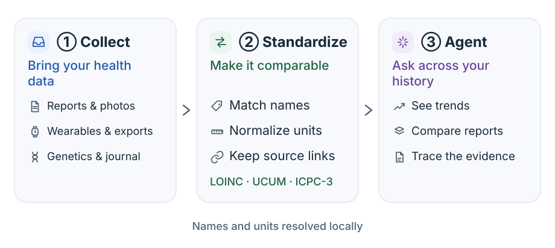
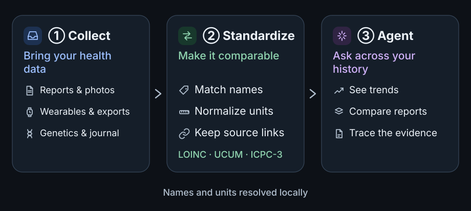

import { OssSource } from "/snippets/oss-facts.jsx";

{/* Generated by scripts/sync-oss.mjs from docs/site/pipeline.md in thetahealth/mirobody at 1.5.10 (b37cd7b). Edit that file upstream: this copy is overwritten on every sync. */}

<OssSource path="docs/site/pipeline.md" lang="ja" />

<Note>このページの日本語版はまだありません。以下は英語の原文です。</Note>

Mirobody collects health records, standardizes names and units, and makes the
results available to the web client, agent and MCP clients.

## From source to answer {#from-source-to-answer}

| Stage         | Result                                                                        |
| ------------- | ----------------------------------------------------------------------------- |
| ① Collect     | Accept files, device data and journal entries; retain their source.           |
| ② Standardize | Resolve recognized indicators to standard codes and convert compatible units. |
| ③ Agent       | Query the selected record, compare results and cite the supporting data.      |

A file can finish uploading before its readings finish processing. Check the
extraction result before assuming that its measurements are available.
Device records may be combined into daily values; queries state which view
and date window they use.

## Accuracy and corrections {#accuracy-and-corrections}

- An unrecognized name remains unresolved; the engine does not invent a code.
- Incompatible units stay separate rather than being forced into one series.
- Query results retain source information so you can inspect the original file.
- Corrected or removed records affect later queries and citation lookups.
- Missing data means no recorded result, not evidence that a condition is absent.

## Data processing {#data-processing}

Terminology and unit conversion run offline. Document recognition and chat
use the models selected by the deployment; cloud models receive the inputs
needed for their tasks. See [model selection](/ja/model-choice) for local,
cloud and hybrid data flows.

For integration details, see the [full pipeline reference](https://github.com/thetahealth/mirobody/blob/b37cd7b24af5251a4364aab30905a7497fc69dcb/docs/pipeline.md).
