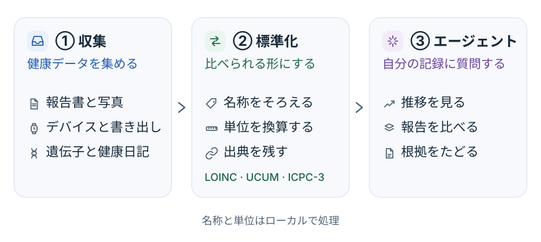
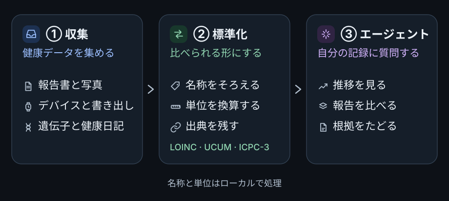

import { OssSource } from "/snippets/oss-facts.jsx";

{/* Generated by scripts/sync-oss.mjs from docs/site/pipeline.ja.md in thetahealth/mirobody at 1.6.0 (5681e71). Edit that file upstream: this copy is overwritten on every sync. */}

<OssSource path="docs/site/pipeline.ja.md" lang="ja" />

Mirobody は健康記録を収集し、名称と単位を標準化して、その結果を Web クライアント・エージェント・MCP クライアントに提供します。

## 元データから回答まで {#元データから回答まで}

| 段階       | 結果                                   |
| -------- | ------------------------------------ |
| ① 収集     | ファイル・デバイスのデータ・日記の記録を受け取り、出どころを保持します。 |
| ② 標準化    | 認識できた指標を標準コードに変換し、互換性のある単位を変換します。    |
| ③ エージェント | 選択した記録に問い合わせ、結果を比較して、裏付けとなるデータを示します。 |

ファイルはアップロードが完了していても、読み取りの処理がまだ終わっていないことがあります。測定値が使えると考える前に、抽出結果を確認してください。
デバイスの記録は1日ごとの値にまとめられることがあり、クエリはどのビューとどの日付範囲を使ったかを示します。

## 正確性と修正 {#正確性と修正}

- 認識できない名称は未解決のままです。エンジンがコードを作り出すことはありません。
- 互換性のない単位は1つの系列にまとめず、別々のまま保持します。
- クエリ結果は出どころの情報を保持するため、元のファイルを確認できます。
- 記録を修正・削除すると、以降のクエリと出典の参照に反映されます。
- データがないことは記録がないことを意味するだけで、その状態がないという証拠にはなりません。

## データの処理 {#データの処理}

用語の解決と単位の変換はオフラインで行われます。文書の認識とチャットは、デプロイが選択したモデルを使います。クラウドモデルに送られるのは、その処理に必要な入力だけです。ローカル・クラウド・ハイブリッドでのデータの流れは[モデルの選び方](/ja/model-choice)を参照してください。

連携の詳細は[パイプラインの全体像](https://github.com/thetahealth/mirobody/blob/5681e7176dce2a63fda1f53813ffef292b433dc1/docs/pipeline.md)（英語）を参照してください。
