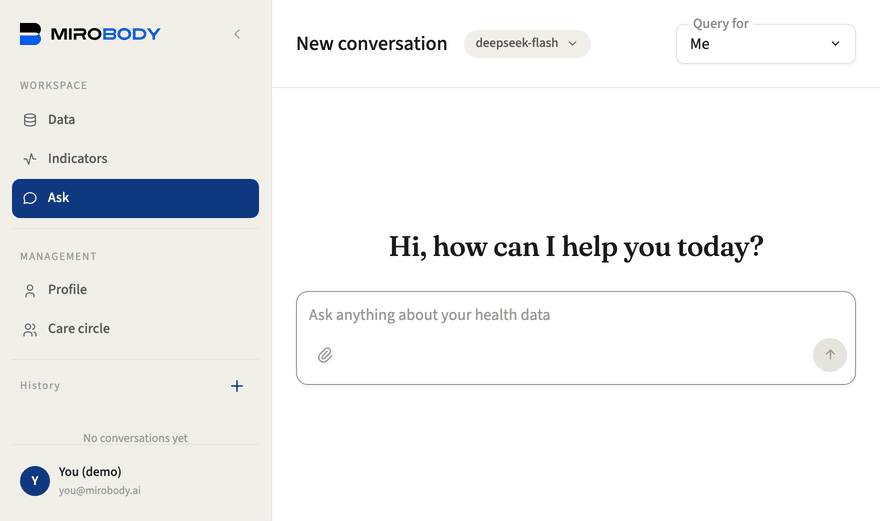
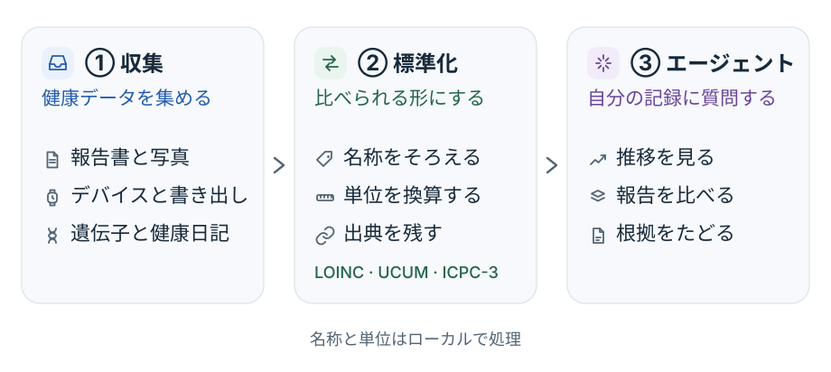
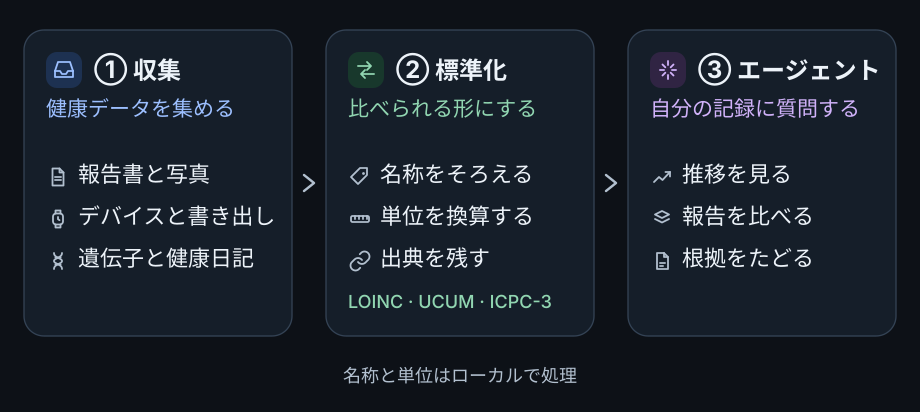

import NameOrigin from "/snippets/ja/name-origin.mdx";

  
オープンソース · セルフホスト · Apache 2.0

  
あなたのからだを、データに映す。

  
ひとつの標準で、あらゆる情報源をまとめ、あなたの全体像を映し出す。健康の行方を理解するための、長く続く記録です。オープンソース版は Docker で動かし、クラウドのモデルも、自分のマシン上のモデルも選べます。

  

    <a className="mb-button mb-button-primary" href="/ja/self-host">Docker で始める →</a>
    <a className="mb-button mb-button-secondary" href="https://github.com/thetahealth/mirobody">GitHub</a>
  

<Frame caption="3つの報告、同じ検査に3つの名前。それを1本の推移に。どの数値にも元のファイルが付いています。">
  
</Frame>

## Mirobody とは

Mirobody は、検査報告、デバイスのデータ、写真、遺伝子ファイルを1つの記録にまとめ、認識した名称と単位を[共通の言語](/ja/concepts/indicators)に変換して、記録を時間をまたいで比較できるようにします。質問すると、元の出典を示したうえで答えます。十分なデータを、十分長く標準化すれば、ひとつのからだについての完全で連続した記録、あなたの Mirobody が得られます。オープンソース版は、この一連の処理を自分のインフラ上で、[Apache 2.0 ライセンス](https://github.com/thetahealth/mirobody)のもとで行います。開発元は Theta Health で、Theta を支える健康データエンジンでもあります。

Mirobody は診断や処方を行わず、回答は医学的な助言ではありません。

<NameOrigin />

<Frame caption="収集・標準化・質問：元のファイルが、出典をたどれる回答になるまでの3段階。">
  
  
</Frame>

## はじめ方

<CardGroup cols={2}>
  <Card title="Docker で実行する" icon="docker" href="/ja/self-host">
    `./deploy.sh` で Web アプリとデモデータを起動し、クラウドかローカルのモデルを選びます。記録は自分の Postgres データベースに残ります。
  </Card>
  <Card title="ウォークスルーを試す" icon="play" href="/ja/walkthrough">
    アップロード、標準化、複数の報告をまたいだ質問、家族との共有、日記の記録まで。
  </Card>
  <Card title="すべてのモデルを手元に置く" icon="microchip" href="/ja/local-models">
    llama.cpp でモデルをローカルに実行します。プラットフォームごとのハードウェア要件とセットアップ手順を確認できます。
  </Card>
  <Card title="自分のエージェントを接続する" icon="plug" href="/ja/tools/mcp-integration">
    Claude Code、Codex、Cursor、Gemini CLI から MCP 経由で記録に問い合わせます。
  </Card>
  <Card title="アプリなしでエンジンを使う" icon="code" href="/ja/tools/mcp-integration#local-terminology-over-stdio">
    名称・測定値・単位を扱うオフラインのエンジンを、MCP クライアントや Python スクリプトからキーなしで使えます。
  </Card>
  <Card title="サーバーにデプロイする" icon="server" href="/ja/deployment/production">
    本番設定、シークレット、HTTPS、アップグレードとバックアップ。
  </Card>
</CardGroup>

## インストールせずに使う

[Theta Web](https://dr.thetahealth.ai/?utm_source=mirobody&utm_medium=docs&utm_campaign=mirobody-to-theta&utm_content=docs_home) や Theta のモバイルアプリで Mirobody を試すと、何もデプロイせずに自分の記録を残せます。合成データの[ライブデモ](https://chat.mirobody.ai/demo?ref=mirobody-docs&lang=ja)は、アカウントなしで試せます。

ソースコード、リリース、サポートは [GitHub](https://github.com/thetahealth/mirobody) にあります。
